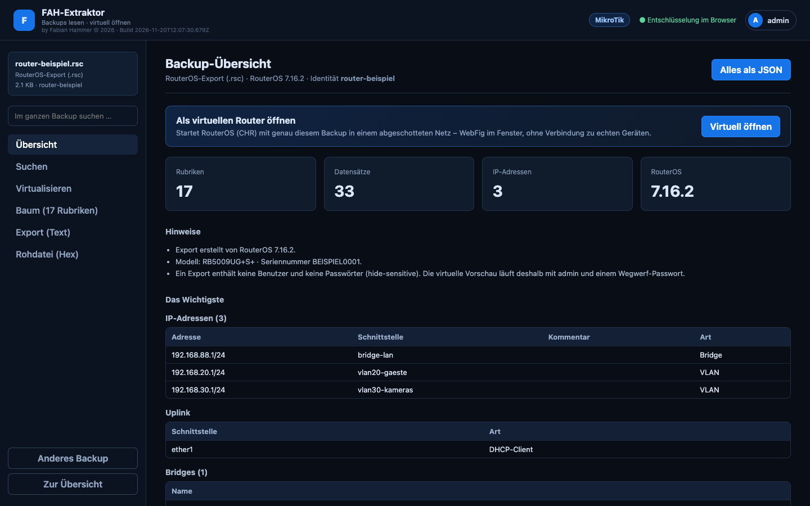
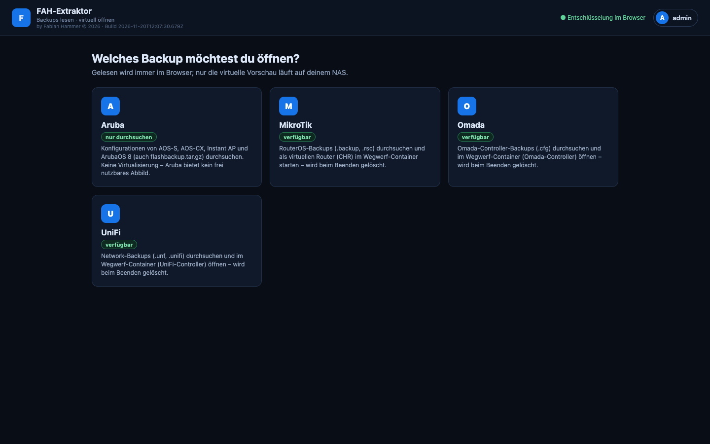
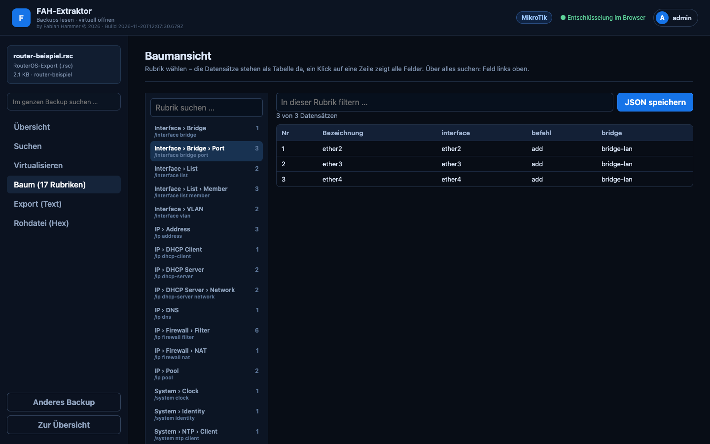
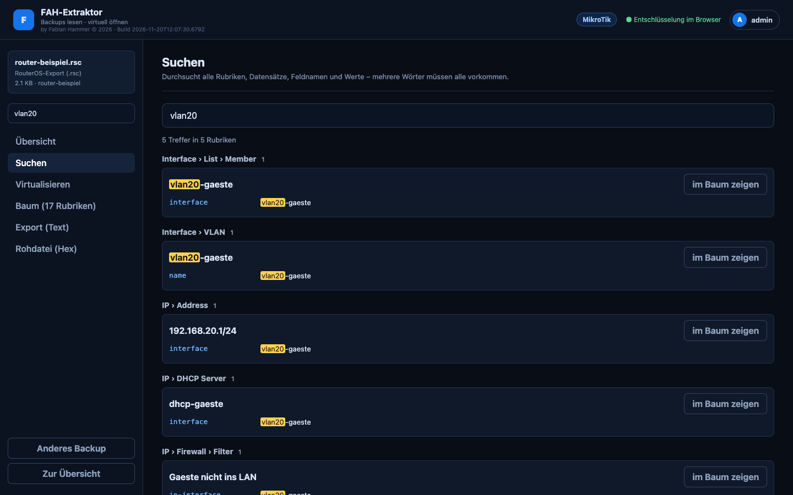

# FAH-Extraktor

Browser-App für Backups von Netzwerkgeräten: **lesen** (im Browser, nichts verlässt den
Rechner) und – wo es geht – **virtuell öffnen**: Das Backup läuft in einer Wegwerf-Sandbox
auf dem NAS in der echten Hersteller-Oberfläche, bevor es auf ein Gerät gespielt wird.

Bis 09.10.2026 hieß die App „UniFi Backup Explorer“. Container-, Netz- und Pfadnamen
(`unifi-backup-explorer(-api)`, Netz `unifi-vorschau`, Präfix `/_explorer/`, Cookie
`fah_explorer`) bleiben aus Kompatibilität unverändert.

## Screenshots

*Aufgenommen mit einer erfundenen MikroTik-Beispielkonfiguration (Adressen aus 192.168.x.x, Seriennummer „BEISPIEL0001“) – kein echtes Backup.*



| Hersteller wählen | Baumansicht |
|---|---|
|  |  |
| **Suche über das ganze Backup** | |
|  | |

## Integrationen

Nach der Anmeldung zeigt die Übersicht eine Kachel je Hersteller (A–Z). Angeboten wird nur, was
ohne Lizenz geht; jede Virtualisierung läuft in einem Wegwerf-Container, der beim Beenden gelöscht wird.

| Integration | Stand | Was geht |
|---|---|---|
| **Aruba** | nur durchsuchen | AOS-S, AOS-CX, Instant AP, ArubaOS 8 (auch `flashbackup.tar.gz`) lesen: Rubriken, Datensätze, Originalzeilen, Suche. Kein virtuelles Abbild frei verfügbar. |
| **MikroTik** | aktiv | `.backup`/`.rsc` lesen (Rubriken, Datensätze, Hex) und als CHR im Wegwerf-Container öffnen (WebFig im Fenster). Virtuell: unverschlüsselte `.backup` mit RouterOS 7. |
| Omada | in Arbeit | Backup (.cfg) mit bekanntem Schlüssel lesbar, Controller als freies Docker-Image – wie UniFi. |
| **UniFi** | aktiv | `.unf`/`.unifi` lesen, Sites exportieren, virtuelle Vorschau im Wegwerf-Controller. |

Entfallen (gehen nicht ohne Lizenz): Barracuda (Backups an die Seriennummer gebunden), Securepoint
(.utm verschlüsselt, UTM nur mit Partnerlizenz), Fortinet (FortiGate-VM nur mit Kauflizenz; der
Leser `src/konfig.js` kann `.conf` trotzdem, die Kachel ist nur ausgeblendet).

## Aruba (nur durchsuchen)

`src/konfig.js` liest die Konfiguration im Browser: Blöcke aus Kopfzeile + eingerückten Unterzeilen
(AOS-S schließt mit `exit`, AOS-CX/ArubaOS 8 trennen mit `!`). Rubrik = Kopf ohne letztes Wort
(`interface vlan`), Datensatz = letztes Wort (`10`), Einzelzeilen landen nach erstem Wort in
„Globale Einstellungen“. Variante und Firmware kommen aus dem Kopf (`; J9773A Configuration Editor;
Created on release #…`, `!Version ArubaOS-CX …`, `version …` + `virtual-controller-*` = Instant AP).
`flashbackup.tar.gz` wird im Browser entpackt (gzip + tar), gelesen wird `config/default.cfg`.
Übersicht: Gerät, IP-Adressen (`ip address …`), WLANs (`wlan ssid-profile` → `essid`).

## UniFi

- `.unf` (Network) und `.unifi` (UniFi OS) öffnen; Entschlüsselung im Browser
- MongoDB-Collections aus `db.gz` als JSON durchsuchen/exportieren, je Dokument die Rohdaten als Hex
- `system.properties`, Metadaten, UCore-Dateien und Rohdateien anzeigen
- entschlüsselten Backupinhalt als ZIP herunterladen
- einzelne Sites als native, importierbare `.unf` exportieren
- nur virtuelle Vorschau und Kundenübergabe übertragen den Network-Teil an das Backend

Hinweis: UniFi-Backups verwenden öffentlich bekannte, fest eingebaute Schlüssel. Die
Verschlüsselung schützt daher nicht vor dem Auslesen durch Dritte.

### Kundenübergabe (UniFi)

Aus einem Single-Site-Export entsteht ein Backup, das der Kunde bei der Ersteinrichtung
seines Controllers einspielt:

- Der Kunde meldet sich mit einem neu vergebenen Admin an. Site-Exporte enthalten keine
  Admins; alte Konten lassen sich daraus nicht wiederherstellen.
- Das Admin-Passwort steht nur als Hash in der Datei. Das Geräte-SSH-Login bekommt den
  neuen Benutzernamen und ein eigenes Zufallspasswort, das der Controller des Kunden im
  Klartext anzeigt. API-Token und SSH-Schlüssel werden entfernt.
- Es bleiben nur bekannte Site-Sammlungen und -Dateien in der Datei. Unbekanntes, Daten
  fremder Sites und Admin-Ereignisse werden ausgelassen und nach dem Erstellen genannt.
- Zugangsdaten, die zur Site gehören (WLAN, RADIUS, VPN), bleiben erhalten und werden vorher
  mit Feldname und Anzahl aufgelistet. Prüfe, ob etwas davon eure Zugänge sind.
- Komplett-Backups werden abgelehnt, weil sie die Konten des Betreibers enthalten. Steht das
  alte Geräte-Passwort oder API-Token noch an anderer Stelle, bricht die Erstellung ab.
- Die `.unf` ist nur mit einem öffentlich bekannten Schlüssel verschlüsselt, behandle sie
  deshalb wie Zugangsdaten.
- Geräte übernehmen das neue SSH-Login erst, wenn sie den Controller des Kunden erreicht
  haben. Bis dahin gilt auf den Geräten noch das alte Login.

### Virtuelle Vorschau (UniFi)

„Virtuell öffnen“ zeigt ein Backup in der echten UniFi-Network-Oberfläche:

- Das Backend startet MongoDB und `lscr.io/linuxserver/unifi-network-application` in
  der Version des Backups (sonst die nächsthöhere) im Docker-Netz `unifi-vorschau`
  (`internal`, kein LAN, kein Internet, keine Ports) und spielt das Backup über den
  Einrichtungsassistenten ein.
- Der Browser schickt nur den Network-Teil (bei `.unifi` ohne Protect/UniFi-OS-Daten).
  Das Backend setzt den Wegwerf-Admin `fah-vorschau` mit Zufallspasswort ein und
  meldet den Browser automatisch an.
- UniFi-OS-Konsolen (UDM, UDR, UCG, …) stehen in der Sandbox als Gateway (Typ `uxg`) in der
  Datenbank – ein eigenständiger Controller verwirft `udm`-Geräte, „Internet“ und „VPN“
  blieben sonst ausgegraut. Die Konsole erscheint mit ihrem echten Portlayout.
- Die Oberfläche läuft unter derselben Domain: Der Extraktor belegt nur `/`,
  `/favicon.svg` und `/_explorer/`, alle anderen Pfade gehen an die Vorschau des
  angemeldeten Kontos. „Im Fenster öffnen“ zeigt sie als Rahmen unter der Kopfzeile der
  App, „Neuer Tab“ daneben.
- Jedes Konto hat eine eigene Vorschau (Container `unifi-vorschau-app-<id>` / `-db-<id>`);
  eine neue ersetzt die eigene alte. Wer sich ein Konto teilt, teilt sich die Vorschau.

## MikroTik

### Lesen (im Browser)

- `.backup` (binär) und `.rsc` (Export, Text) öffnen; die Datei bleibt im Browser.
- Baumansicht: Rubriken (z. B. `IP › Addresses`) → Datensätze → Felder mit Typ und Wert,
  dazu die Rohdaten jedes Datensatzes als Hex-Dump; Volltextsuche, JSON-Export je Rubrik,
  die ganze Datei als Hex.
- Übersicht: erkannte RouterOS-Version, Identität, Adressen, Hinweise.
- Verschlüsselte `.backup` (RC4/AES) werden erkannt, aber nicht gelesen.

### Virtualisieren (CHR im Fenster)

„Virtualisieren“ startet das Backup als MikroTik Cloud Hosted Router (CHR) unter QEMU/KVM
auf dem NAS und zeigt WebFig im Fenster der App:

1. **Dialog:** CHR-Version (Vorschlag = neueste stabile Version der Hauptversion des Backups
   von `upgrade.mikrotik.com`, sonst eine Version aus dem Cache oder eine frei eingegebene),
   Zugangsweg, Benutzer/Passwort des Router-Admins – nach dem Einspielen gelten die Benutzer
   des Backups. Jede Einstellung erklärt sich in ein bis zwei Sätzen.
2. **Backend:** lädt `chr-<version>.img` einmalig von `download.mikrotik.com` in das
   Docker-Volume `fah-chr-cache` (≈45 MB ZIP, 128 MiB entpackt, Fortschritt im Ablauf),
   startet den Container `unifi-vorschau-chr-<id>` (Alpine + QEMU, `/dev/kvm`, 1 CPU,
   768 MiB Deckel, 384 MB Gast-RAM) im internen Netz `unifi-vorschau` und übergibt Auftrag
   und Backup als Archiv in den Container – kein Host-Pfad, keine Geheimnisse in
   Umgebungsvariablen.
3. **Im Container:** Das Backup liegt auf einer kleinen FAT-Platte, die RouterOS selbst
   einhängt; über die serielle Konsole wird es mit `/system backup load` eingespielt
   (`.rsc`: `/import`), der Router startet neu, Anmeldung mit dem Zugang aus dem Dialog,
   Scheduler und laufende Skripte werden angehalten.
4. **Zugang „Lokal“:** Der Vorschau-Zugang hängt sich als Port in die Bridge, die die
   gewählte Router-Adresse trägt (Vorgabe `192.168.250.1`, sonst die erste
   Bridge-Adresse). WebFig wird vom www-Port des Routers (auch wenn er z. B. 5999 ist)
   auf Port 80 des Containers gespiegelt – nur im internen Docker-Netz erreichbar.
   **„WAN/Remote“:** Der Router startet mit der MAC seines Uplink-Ports neu und holt sich
   per DHCP eine Adresse aus einem Wegwerf-Netz – Zugang wie von außen.
5. Der Extraktor reicht WebFig unter `/webfig/` auf seiner eigenen Adresse durch (gleiche
   Origin, Anmeldung nötig). WebFig fragt nach Benutzer und Passwort; die Bereit-Ansicht
   zeigt beides mit Kopierknopf.

Dauer etwa eine Minute (gemessen ~42 s bei vorhandenem Image), beim ersten Laden einer
RouterOS-Version länger. Ende per Knopf, 30 Minuten ohne Nutzung oder nach 8 Stunden –
wie bei UniFi.

Der virtuelle Router ist abgeschottet: Die Kundenports sind tote Hubs ohne Verkehr, die
Verwaltungs-NIC ein QEMU-Benutzernetz mit `restrict=on` (der Router erreicht weder den
Container noch LAN oder Internet), das Docker-Netz ist `internal`.

### Standard-Zugang MikroTik

Benutzerverwaltung → „Standard-Zugang MikroTik“: Benutzer und Passwort werden im
Virtualisieren-Dialog vorbelegt. Gespeichert in `./daten/einstellungen.json` (Rechte 0600)
– im Klartext, für alle angemeldeten Konten sichtbar und auf dem NAS durch die Volume-ACL
lesbar. Nur eintragen, wenn das gewollt ist; sonst den Zugang je Vorschau eintippen.

### Grenzen (Stufe 1)

- Nur **unverschlüsselte `.backup` mit RouterOS 7**. Verschlüsselte Backups auf dem Router mit
  `/system backup save dont-encrypt=yes` erneut sichern. RouterOS-6-Backups: nur Baumansicht.
- `.rsc` ist Beta: Ein Export enthält keine Benutzer (Vorschau mit `admin` und
  Wegwerf-Passwort) und keine MACs (Schnittstellen nach `default-name`); der Import bricht
  beim ersten Fehler ab – `.backup` bevorzugen.
- **WAN-Modus** nur per DHCP über den Uplink. Die Kundenskripte (DDNS, VPN, Heartbeat) laufen
  dann scharf gegen das Wegwerf-Netz, ändern Konfiguration und kosten CPU.
- **Hotspot-Netze:** Aus einem Hotspot-Netz ist WebFig nie erreichbar (dynamische
  `hs-input`-Regeln) – der Dialog markiert solche Adressen; eine andere wählen.
- Adresse auf einem VLAN-Interface: kein Zugangsweg (klare Fehlermeldung), Bridge-Adresse wählen.
- **Kundenskripte**, die beim Start laufen (Scheduler `startup`), greifen vor dem Anhalten noch
  kurz – die Vorschau kann minimal von der Konfiguration abweichen (z. B. deaktivierter
  WireGuard-Tunnel). Die Hinweise stehen in der Bereit-Ansicht.
- Nach dem Restore fehlt gelegentlich ein deaktivierter SFP-Port (RouterOS-Eigenheit) –
  nur ein Hinweis, kein automatischer Neustart.
- Ein `.backup` enthält Klartext-Geheimnisse (PPP-, Hotspot-, WLAN-, VPN-Schlüssel). Sie liegen
  im Browser, kurz im Backend-Speicher und in der Schreibschicht des Wegwerf-Containers, die
  mit ihm verschwindet.

## Anmeldung und Benutzer

Ohne Anmeldung ist nur die Anmeldeseite (`/_explorer/anmeldung`) erreichbar. nginx
fragt vor der Explorer-Seite per `auth_request` beim Backend nach; API, Vorschau-Proxy
und WebSockets prüft das Backend selbst (Cookie `fah_explorer`, wird nicht an die
Sandbox weitergereicht).

- Erststart: `admin` / `admin` (Administrator). Bis zur Änderung zeigt die App einen Hinweis.
- Menü oben rechts: „Mein Konto“ (Name/Passwort, mit aktuellem Passwort), „Benutzerverwaltung“
  (nur Admins: anlegen, umbenennen, Passwort setzen, Rolle, löschen; Schalter
  „Registrierung auf der Anmeldeseite“, Standard aus; „Standard-Zugang MikroTik“), „Abmelden“.
- Rollen: Benutzer nutzen Extraktor und Vorschau, Administratoren verwalten zusätzlich Konten
  und können fremde Vorschauen beenden. Der letzte Administrator kann weder gelöscht noch
  herabgestuft werden.
- Selbst registrierte Konten sind sofort nutzbar (Rolle Benutzer).
- Speicher: `./daten/benutzer.json`, `./daten/sitzungen.json` (scrypt-Hashes bzw.
  SHA-256 der Sitzungs-Cookies) und `./daten/einstellungen.json`. Sitzungen gelten 30 Tage
  ab der letzten Nutzung.
- 10 Fehlversuche je Absender bzw. Benutzername → 15 Minuten Pause.
- Notfall: `./manage.sh admin-reset` setzt `admin` / `admin` als Administrator zurück.

## Mitschau & Co-Browsing (internes Werkzeug)

Für die gegenseitige Hilfe im Team: ein Kollege kann der Oberfläche eines anderen zusehen und
– nach Zustimmung – mitsteuern. Technik: je angemeldeter Oberfläche eine WebSocket zum Backend
(`/_explorer/ws/mitschau`, eigener nginx-Block), das Backend (`server/mitschau.js`) vermittelt;
der WebSocket-Server (`server/ws.js`) kommt ohne Fremdpaket aus. Oberfläche: `src/mitschau.js`
(eigenes Overlay, Banner, Dialoge).

Grundsätze (bewusst strenger als eine reine Aufsicht):

- **Nichts heimlich.** Zusehen UND Steuern starten erst, wenn die gastgebende Seite ausdrücklich
  zustimmt. Während der Mitschau zeigt dort durchgehend ein Balken, wer zusieht bzw. steuert; beide
  Seiten können jederzeit beenden.
- **Sitzungsliste** (nur Admins, über das Benutzermenü → „Mitschau & Sitzungen“): wer ist angemeldet,
  welche Integration/Backup/Ansicht ist offen, läuft eine Vorschau.
- **Einladen in beide Richtungen:** jeder darf jemanden in die *eigene* Sitzung einladen
  (Nutzer↔Admin, Admin↔Admin); nur Admins dürfen zusätzlich „Zusehen anfragen“. Beides endet mit
  derselben Zustimmung der gastgebenden Seite.
- **Spiegel statt Fernzugriff:** die gastgebende Seite schickt einen bereinigten DOM-Schnappschuss
  ihres Arbeitsbereichs (Inhalt, Scroll, Zeiger); der Beobachter rendert ihn in einem abgeschotteten
  iframe. **Passwortfelder werden nie übertragen**, das Vorschau-Fenster (fremde Origin) ebenfalls
  nicht. Steuerung = einzelne Klick-/Tipp-/Scroll-Ereignisse, nur solange die Freigabe gilt.

## Betrieb

- **Voraussetzungen:** Docker mit Compose v2 und – für die MikroTik-Vorschau – `/dev/kvm`
  auf dem Host (`ls -l /dev/kvm`). Fehlt das Gerät, startet der virtuelle Router ohne KVM
  (TCG) und ist sehr langsam.
- **Ressourcen:** je UniFi-Vorschau ~1 GB RAM (Deckel 2,5 + 1 GB), je MikroTik-Vorschau
  höchstens 0,75 GB und 1 CPU. Insgesamt laufen höchstens `VORSCHAU_MAX` (6) Vorschauen,
  beide Arten zusammengezählt; sind alle belegt, sieht man wer sie nutzt. Die
  Wegwerf-Container haben niedrige CPU-Anteile (256), damit andere Dienste Vorrang haben.
- **Cache:** Docker-Volume `fah-chr-cache` (extern; `manage.sh` legt es an), wächst um
  128 MiB je RouterOS-Version, keine automatische Bereinigung. Leeren:
  `./manage.sh down && docker volume rm fah-chr-cache && ./manage.sh up`.
- **Update, `down` und ein Neustart des Backends beenden alle laufenden Vorschauen**
  (UniFi und MikroTik) – Läufe gibt es nur im Speicher. Vorher in der Übersicht nachsehen,
  wer gerade eine Vorschau nutzt.
- Alle Wegwerf-Container tragen das Label `fah.unifi-vorschau=1` (dazu `.lauf=<id>` und
  `.art=unifi|mikrotik`); Backend-Start und `manage.sh down` räumen sie weg. Eine zweite
  Instanz auf demselben Host nie parallel betreiben (gleiche Labels).
- Der WebFig-Port eines virtuellen Routers ist nur im internen Docker-Netz `unifi-vorschau`
  erreichbar; nach außen gibt es ihn nur über den angemeldeten Proxy des Extraktors.

## Entwicklung

```bash
npm install
npm run dev        # Vite-Dev-Server, URL wird angezeigt
npm run build      # Produktionsbuild nach dist/
```

Tests ohne Docker: `node --test test/vorschau.test.mjs` (Proxy-Köpfe, Versionswahl,
Obergrenze, MikroTik-Optionen; optional `VORSCHAU_TESTBACKUP=<pfad>`),
`node --test test/konten.test.mjs` (Konten und Sitzungen), `node --test test/mikrotik.test.mjs`
(Backup-Decoder, `.rsc`-Parser, Hex – synthetische Daten; ein echtes Backup nur über
`MIKROTIK_TESTBACKUP=<pfad>`). Die Durchläufe gegen das NAS liegen in `test/nas/` (nicht in
der Release-ZIP). Der Produktionsbuild passiert im Docker-Build auf dem Server.

## Installation und Update (manage.sh)

Neu installieren und aktualisieren geht gleich: `fah-extraktor.zip` und `manage.sh`
in den Projektordner (bei der Erstinstallation ein leerer Ordner, z. B.
`/volume3/docker/unifi-extraktor`) legen und

```bash
./manage.sh update
```

ausführen. Das Skript entpackt, baut zuerst das Image der MikroTik-Vorschau
(`chr/Dockerfile.chr` → `fah-extraktor-chr`), legt das Volume `fah-chr-cache` an, baut die
beiden Dienste neu (erst bauen, dann tauschen – scheitert ein Bau, läuft die alte Version
weiter), startet und zeigt die Adresse an. Laufende Vorschauen enden dabei.

- **Erster Deploy nach der Umbenennung:** Die alte `manage.sh` kennt das Muster
  `fah-extraktor*.zip` noch nicht – einmalig
  `DEPLOY_GLOB="fah-extraktor*.zip" ./manage.sh update`; danach greift das neue Muster
  (die alten Muster `unifi-extraktor*.zip` und `unifi-backup-explorer-deploy*.zip` bleiben
  erkannt).
- **Port:** Bei der Erstinstallation nimmt `manage.sh` den ersten freien Port ab 45913 und
  schreibt ihn als `WEB_PORT` in `.env`. Vor jedem Start wird erneut geprüft; ein Port, den
  die Container dieses Projekts selbst belegen, gilt als eigener und bleibt. Anzeigen bzw.
  ändern: `./manage.sh port [<PORT>]`.
- `.env`, `./daten` und das Volume `fah-chr-cache` fasst ein Update nie an.
- `./manage.sh down` stoppt die Dienste und entfernt alle Wegwerf-Container; das
  Cache-Volume bleibt.

Danach ist die App unter `http://SERVER-IP:<WEB_PORT>` erreichbar (Standard 45913). Für
Zugriffe über einen Hostnamen muss ein HTTPS-Reverse-Proxy vorgeschaltet werden, da Browser
die verwendete Web-Crypto-API (und die Zwischenablage für die Kopierknöpfe) außerhalb von
`localhost` nur in einem sicheren Kontext freigeben.

## Update / Neu bauen

`./manage.sh update` (siehe oben) oder `./manage.sh rebuild` (baut auch das
MikroTik-Vorschau-Image neu).
